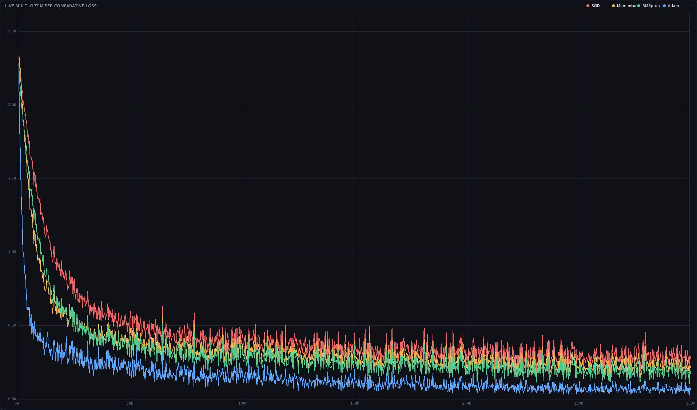
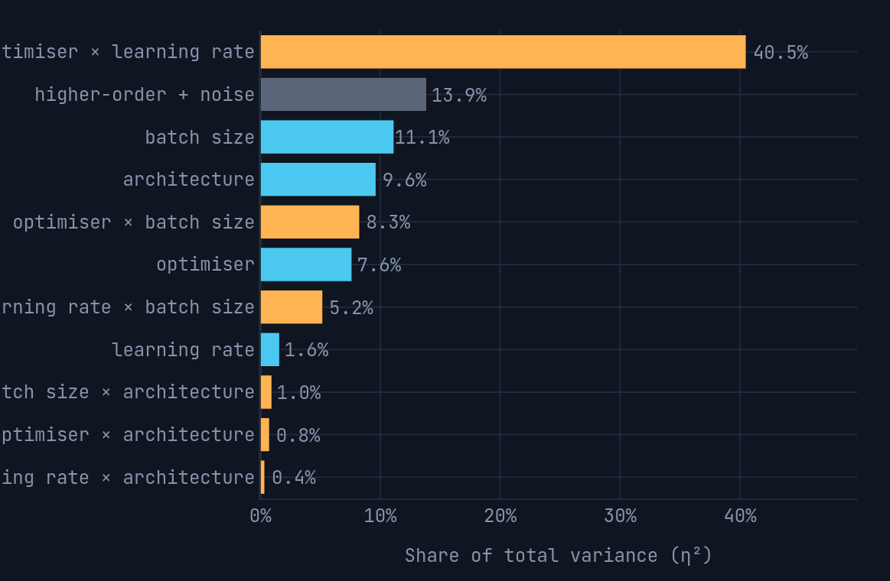
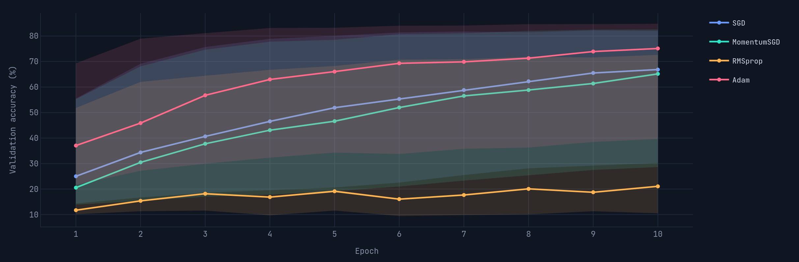
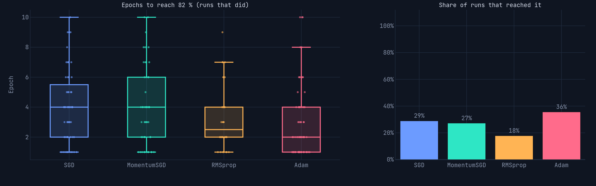
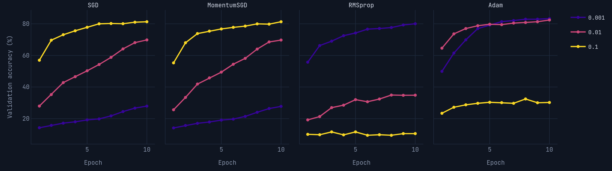
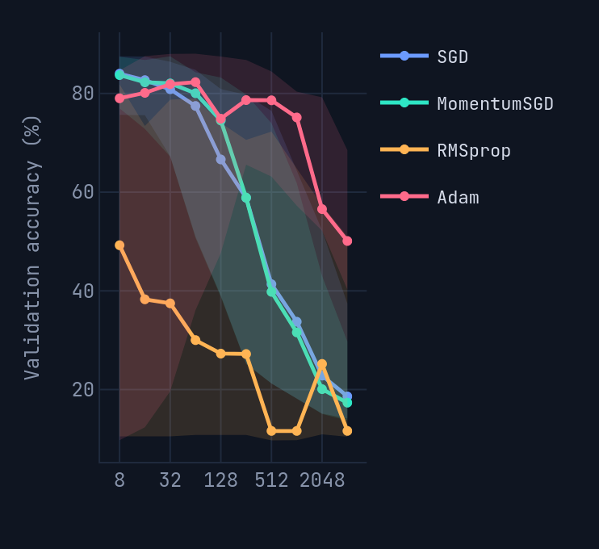
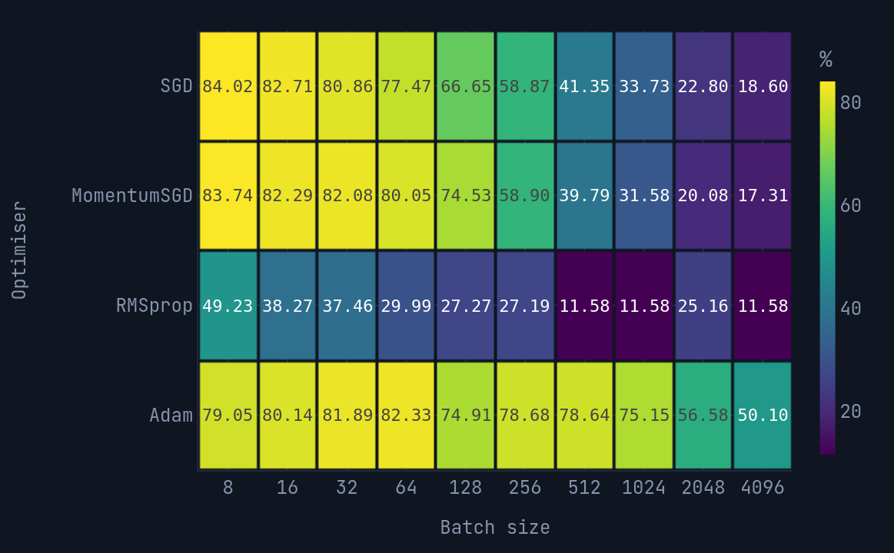
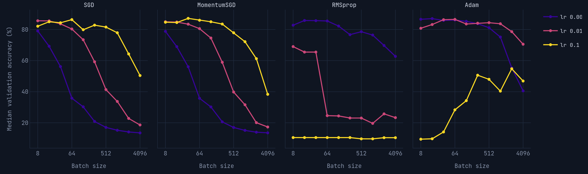

# NeuralEngine

A neural network engine written in **C++20**, built from scratch to explore the mathematics, algorithms, and implementation details behind neural networks.

NeuralEngine implements the core training pipeline without relying on a high-level machine-learning framework. It includes tensor storage, fully connected layers, activation functions, loss calculation, backpropagation, stochastic gradient descent, batch normalisation, and an MNIST training pipeline.

The project focuses on understanding how neural networks work internally, from tensor operations and derivatives to gradient propagation, batch statistics, and parameter updates.

## Features

- **Tensor library:** Shape-aware tensor storage and indexing.
- **Dense layers:** Fully connected layers with configurable weight initialisation.
- **Activation functions:** ReLU for hidden layers.
- **Loss function:** Numerically stable softmax cross-entropy.
- **Backpropagation:** Analytical gradients calculated directly using the chain rule.
- **Optimisers:** SGD, MomentumSGD, RMSprop, and Adam.
- **Mini-batch training:** Batched forward propagation and backpropagation.
- **Batch normalisation:** Learnable scale and shift parameters with batch-statistics-based normalisation.
- **CPU parallelisation:** OpenMP parallelisation for computationally intensive operations.
- **SIMD vectorisation:** Compiler-assisted vectorisation of arithmetic and tensor operations.
- **Tiled computation:** Tiled input-gradient computation to distribute work across CPU threads.
- **Adaptive parallelisation:** Workload thresholds to avoid parallelisation overhead on smaller operations.
- **MNIST support:** Dataset loading, training, and test evaluation.
- **Gradient verification:** Tests comparing analytical gradients with numerical approximations.
- **NeuralEngine Studio:** A graphical interface for experimenting with the engine when built with the required Raylib dependency.

## CPU Optimisation

NeuralEngine uses CPU-level optimisations to improve training and
inference performance without depending on external numerical
computing libraries.

### OpenMP Parallelisation

OpenMP is used to parallelise computationally intensive operations.
Independent output elements and gradient calculations are distributed
across multiple CPU threads.

Static scheduling is used for workloads with relatively uniform
iteration costs. Parallel execution is conditional on workload size,
avoiding unnecessary threading overhead for smaller operations.

### SIMD Vectorisation

Arithmetic-heavy loops are structured to allow compiler-assisted
SIMD vectorisation. This is particularly useful for tensor operations,
matrix calculations, forward propagation, and gradient computation.

### Tiled Gradient Computation

Input-gradient computation is divided into smaller tiles. Each
parallel worker operates on a disjoint region of the gradient tensor,
reducing write conflicts and improving work distribution.

### Performance Considerations

Parallel execution does not guarantee better performance for every
workload. Thread count, memory access patterns, workload size, and
threading overhead all influence performance.

## MNIST Results

NeuralEngine was trained on the MNIST handwritten-digit dataset using a fully connected neural network.

### Training Configuration

| Metric | Value |
|---|---:|
| Training dataset | 60,000 images |
| Test dataset | 10,000 images |
| Architecture | 784 → 512 → 256 → 128 → 64 → 10 |
| Batch size | 32 |
| Epochs | 1 |
| Mean training loss | 0.404321 |
| Training time | 7.80 seconds |
| Testing time | 0.35 seconds |
| Total time | 8.16 seconds |
| Test accuracy | **95.49%** |
| Correct predictions | 9,549 / 10,000 |

### Performance Comparison

An earlier measured run took 69.30 seconds, while the batch-size-32
run completed in 8.16 seconds.

| Metric | Earlier Run | Batch Size 32 |
|---|---:|---:|
| Total time | 69.30 s | 8.16 s |
| Test accuracy | 94.34% | 95.49% |

The newer run completed approximately 8.5 times faster.

These runs used different configurations, so this comparison
represents observed performance rather than an isolated measurement
of OpenMP's speedup.

These results are from a reported training run. Results may vary with changes to initialisation, data ordering, hyperparameters, and implementation details.

## Mathematical Foundations

### 1. Forward Propagation

For layer $l$, the pre-activation output is:

$$
\mathbf{z}^{(l)} = W^{(l)}\mathbf{a}^{(l-1)} + \mathbf{b}^{(l)}
$$

Here:

- $W^{(l)}$ is the weight matrix.
- $\mathbf{b}^{(l)}$ is the bias vector.
- $\mathbf{a}^{(l-1)}$ is the input activation vector.
- $\mathbf{z}^{(l)}$ is the pre-activation output.

For hidden layers, ReLU produces the activation vector:

$$
\mathbf{a}^{(l)} = \mathrm{ReLU}\left(\mathbf{z}^{(l)}\right) = \max\left(\mathbf{0},\mathbf{z}^{(l)}\right)
$$

The final layer produces logits without applying ReLU. These logits are passed to the loss function.

### 2. Softmax Cross-Entropy

For logits $z_1,z_2,\ldots,z_C$, the softmax probability of class $j$ is:

$$
p_j = \frac{e^{z_j}}{\sum_{k=1}^{C} e^{z_k}}
$$

To improve numerical stability, the loss uses the Log-Sum-Exp formulation. Let:

$$
m = \max_{1\leq j\leq C} z_j
$$

For target class $y$, the cross-entropy loss is:

$$
\mathcal{L} = m + \ln\left(\sum_{j=1}^{C} e^{z_j-m}\right) - z_y
$$

For a one-hot target vector $\mathbf{y}$, the gradient with respect to the logits simplifies to:

$$
\frac{\partial\mathcal{L}}{\partial\mathbf{z}} = \mathbf{p} - \mathbf{y}
$$

This simplification avoids explicitly calculating the full softmax Jacobian during backpropagation.

### 3. Dense-Layer Backpropagation

Define the incoming gradient for layer $l$ as:

$$
\boldsymbol{\delta}^{(l)} = \frac{\partial\mathcal{L}}{\partial\mathbf{z}^{(l)}}
$$

The weight gradient is the outer product of the error vector and the preceding layer's activation:

$$
\frac{\partial\mathcal{L}}{\partial W^{(l)}} = \boldsymbol{\delta}^{(l)}\left(\mathbf{a}^{(l-1)}\right)^{T}
$$

The bias gradient is:

$$
\frac{\partial\mathcal{L}}{\partial\mathbf{b}^{(l)}} = \boldsymbol{\delta}^{(l)}
$$

The gradient propagated to the previous activation vector is:

$$
\frac{\partial\mathcal{L}}{\partial\mathbf{a}^{(l-1)}} = \left(W^{(l)}\right)^{T}\boldsymbol{\delta}^{(l)}
$$

For a hidden ReLU layer, the gradient is multiplied elementwise by the derivative of ReLU:

$$
\boldsymbol{\delta}^{(l-1)} = \left[\left(W^{(l)}\right)^{T}\boldsymbol{\delta}^{(l)}\right] \odot \mathbf{1}_{\mathbf{z}^{(l-1)}>0}
$$

Here, $\odot$ denotes elementwise multiplication, and the indicator vector is one where the corresponding pre-activation is positive and zero otherwise.

NeuralEngine implements these operations directly rather than relying on an external automatic differentiation framework.

### 4. Mini-Batch Training

Instead of processing only one example before updating the parameters, mini-batch training processes a group of $B$ examples together.

For individual losses $\mathcal{L}_1,\mathcal{L}_2,\ldots,\mathcal{L}_B$, the mean batch loss is:

$$
\mathcal{L}_{\mathrm{batch}} = \frac{1}{B}\sum_{i=1}^{B}\mathcal{L}_i
$$

This formulation gives each example equal weight in the batch objective.

For example, a batch of 32 images produces a mean loss over those 32 examples. The gradients are propagated through the batch, and the optimiser updates the parameters according to the resulting gradients.

#### Gradient scaling

For one example, the gradient of softmax cross-entropy with respect to the logits is:

$$
\frac{\partial\mathcal{L}_i}{\partial\mathbf{z}_i} = \mathbf{p}_i - \mathbf{y}_i
$$

For the mean batch loss, it becomes:

$$
\frac{\partial\mathcal{L}_{\mathrm{batch}}}{\partial\mathbf{z}_i} = \frac{1}{B}\left(\mathbf{p}_i - \mathbf{y}_i\right)
$$

This distinction matters when implementing backpropagation.

Dense-layer weight and bias gradients are accumulated across examples. If the incoming gradients have already been scaled by $1/B$, the accumulated parameter gradients must not be divided by $B$ a second time.

The same principle applies to BatchNorm's learnable parameters. However, BatchNorm's input-gradient formula contains its own $1/B$ factor because of the derivative through the batch mean and variance. That factor is part of the mathematical derivative, not a second generic averaging operation.

### 5. Batch Normalisation

Batch normalisation (BatchNorm) normalises activations across a mini-batch for each feature. It then applies learnable scale and shift parameters.

For one feature, let $x_1,x_2,\ldots,x_B$ be the activations of that feature across a batch of $B$ examples.

#### Step 1: Calculate the batch mean

$$
\mu_B = \frac{1}{B}\sum_{i=1}^{B} x_i
$$

The mean represents the average activation for that feature in the current batch.

#### Step 2: Calculate the batch variance

$$
\sigma_B^2 = \frac{1}{B}\sum_{i=1}^{B}\left(x_i-\mu_B\right)^2
$$

The variance measures how far the activations are spread around their mean. This expression uses the population variance convention for the current batch.

#### Step 3: Normalise the activations

$$
\hat{x}_i = \frac{x_i-\mu_B}{\sqrt{\sigma_B^2+\epsilon}}
$$

Here, $\epsilon$ is a small positive constant that helps prevent division by zero and improves numerical stability.

The normalised values have approximately zero mean and unit variance when the variance is nonzero and $\epsilon$ is small relative to it.

#### Step 4: Apply learnable scale and shift

$$
y_i = \gamma\hat{x}_i + \beta
$$

Here:

- $\gamma$ is the learnable scale parameter.
- $\beta$ is the learnable shift parameter.
- $y_i$ is the output activation.

The scale and shift allow the network to learn an appropriate transformation after normalisation rather than being restricted to the normalised distribution.

#### Backpropagation through BatchNorm

Let:

$$
g_i = \frac{\partial\mathcal{L}}{\partial y_i}
$$

be the gradient arriving from the next operation.

The gradient with respect to the shift parameter is:

$$
\frac{\partial\mathcal{L}}{\partial\beta} = \sum_{i=1}^{B} g_i
$$

The gradient with respect to the scale parameter is:

$$
\frac{\partial\mathcal{L}}{\partial\gamma} = \sum_{i=1}^{B} g_i\hat{x}_i
$$

Both gradients accumulate contributions from every example in the batch.

The input gradient is more involved because each input affects its own normalised value and the shared batch mean and variance.

Define:

$$
r = \frac{1}{\sqrt{\sigma_B^2+\epsilon}}
$$

Then the input gradient is:

$$
\frac{\partial\mathcal{L}}{\partial x_i} = \frac{\gamma r}{B}\left[B g_i - \sum_{k=1}^{B} g_k - \hat{x}_i\sum_{k=1}^{B} g_k\hat{x}_k\right]
$$

This expression captures the direct path through the input as well as the indirect paths through the batch mean and variance.

Consequently, the gradient for one example depends on other examples in the same batch. BatchNorm's backward pass is not merely an elementwise derivative.

#### Batch size and BatchNorm

When $B=1$, the batch variance is zero. The normalised activation becomes zero under the standard formula, leaving the output determined by the shift parameter. The input gradient through this normalisation operation is also zero for that single example.

This is one reason BatchNorm is generally used with batches containing multiple examples.

### BatchNorm Behaviour with Small Mini-Batches

BatchNorm estimates the mean and variance of each feature using the
current mini-batch. With very small batches, these estimates can
become noisy and poorly represent the underlying activation
distribution.

During experiments with NeuralEngine, small-batch training worked
without BatchNorm but failed to learn effectively when BatchNorm
was enabled under the tested configuration.

This observation is consistent with research identifying unreliable
batch-statistics estimates as a limitation of BatchNorm with small
mini-batches.

Relevant research:

- Wu and He, *Group Normalization*, ECCV 2018.
- Yong et al., *Momentum Batch Normalization for Deep Learning
  with Small Batch Size*, ECCV 2020.
- Yao et al., *Cross-Iteration Batch Normalization*, CVPR 2021.

This does not mean BatchNorm always fails with small batches.
Its behaviour depends on the architecture, batch size, and
training configuration.

### 6. Optimisation Algorithms and Learning Rates

An optimiser updates trainable parameters using gradients produced by backpropagation. NeuralEngine includes four optimisers: plain stochastic gradient descent (SGD), MomentumSGD, RMSprop, and Adam. They all use the same basic objective (move parameters in a direction that reduces the loss) but differ in how they use the current gradient and information retained from previous updates.

Let $\theta$ represent a trainable parameter, $g_t=\nabla_\theta\mathcal{L}_t$ its gradient at update $t$, and $\eta$ the learning rate. The following rules apply to trainable weights and biases; BatchNorm's learnable scale and shift parameters are also updated by the optimiser implementations.

#### 6.1 Stochastic Gradient Descent (SGD)

SGD applies the current gradient directly:

$$
\theta_t = \theta_{t-1} - \eta g_t
$$

The constructor takes the learning rate:

```cpp
neural::SGD optimizer(0.01F);
```

`learning_rate` must be finite and greater than zero. SGD has no moving-average state to preserve between calls, so each update depends only on the gradient currently stored by the layer. It is the simplest baseline for comparing the other optimisers.

#### 6.2 MomentumSGD

MomentumSGD keeps a moving estimate of recent gradients. This can reduce oscillation in directions where gradients repeatedly change sign and build up updates in directions where gradients consistently point the same way.

The implementation supports two velocity conventions. With `use_norm` enabled, the velocity is an exponential moving average of gradients:

$$
v_t = \mu v_{t-1} + (1-\mu)g_t
$$

With `use_norm` disabled, it uses the conventional unnormalised momentum recurrence:

$$
v_t = \mu v_{t-1} + g_t
$$

The parameter update is

$$
\theta_t = \theta_{t-1} - \eta v_t
$$

The constructor accepts the learning rate, momentum coefficient, and whether to use the normalised velocity form. The header may provide default arguments for the latter two parameters; the explicit form is:

```cpp
neural::MomentumSGD optimizer(0.01F, 0.9F, true);
```

- `learning_rate`: positive, finite step-size multiplier.
- `momentum`: coefficient $\mu$ in the range $[0,1)$.
- `use_norm`: `true` selects $(1-\mu)g_t$ scaling; `false` uses the unnormalised gradient in the velocity recurrence.

MomentumSGD stores separate velocity state for each Dense layer and BatchNorm layer, including the corresponding parameter groups. Keep the same optimiser instance throughout training so that this history is not discarded between updates.

#### 6.3 RMSprop

RMSprop adapts the effective step size for each parameter using an exponential moving average of squared gradients. Parameters with consistently large gradients receive smaller updates, while parameters with smaller gradients can receive relatively larger updates.

The running squared-gradient estimate is

$$
s_t = \rho s_{t-1} + (1-\rho)g_t^2
$$

and the update is

$$
\theta_t = \theta_{t-1} - \eta\frac{g_t}{\sqrt{s_t}+\epsilon}
$$

Here, $\rho$ is the decay coefficient and $\epsilon$ is a small positive constant used to avoid division by zero. In the implementation, the constructor's second argument is named `momentum`, but mathematically it acts as this squared-gradient decay coefficient; it is not the velocity term used by MomentumSGD.

The explicit constructor form is:

```cpp
neural::RMSprop optimizer(0.001F, 0.9F, true);
```

- `learning_rate`: positive, finite learning rate.
- `momentum`: decay coefficient $\rho$, in $[0,1)$, for the moving average of squared gradients.
- `use_norm`: accepted by the constructor for API consistency, but it does not alter the RMSprop update described above in the current implementation.

RMSprop stores the moving squared-gradient estimates separately for each Dense and BatchNorm layer. Reuse the same optimiser object across training updates to retain these estimates.

#### 6.4 Adam

Adam combines a moving average of gradients with a moving average of squared gradients. The first moment tracks gradient direction; the second moment tracks gradient magnitude. Since both moving averages start at zero, Adam applies bias correction, especially important during the first updates.

The first moment is

$$
m_t = \beta_1m_{t-1} + (1-\beta_1)g_t
$$

and the second moment is

$$
v_t = \beta_2v_{t-1} + (1-\beta_2)g_t^2
$$

Bias-corrected estimates are

$$
\hat{m}_t = \frac{m_t}{1-\beta_1^t}, \qquad
\hat{v}_t = \frac{v_t}{1-\beta_2^t}
$$

The parameter update is

$$
\theta_t = \theta_{t-1} - \eta\frac{\hat{m}_t}{\sqrt{\hat{v}_t}+\epsilon}
$$

The constructor accepts the learning rate and both exponential-decay coefficients:

```cpp
neural::Adam optimizer(0.001F, 0.9F, 0.999F);
```

- `learning_rate`: positive, finite learning rate.
- `beta1`: first-moment decay coefficient $\beta_1$, in $[0,1)$.
- `beta2`: second-moment decay coefficient $\beta_2$, in $[0,1)$.

A common starting configuration is $\beta_1=0.9$ and $\beta_2=0.999$, although the suitable learning rate and coefficients depend on the model and training setup. Adam maintains first- and second-moment arrays for weights and biases, and for BatchNorm's scale and shift parameters. Its state includes a timestep used for bias correction. The timestep advances when that layer's optimiser state is updated, so state must persist across calls.

#### 6.5 Comparing the optimisers

| Optimiser | State retained between updates | Main idea |
|---|---|---|
| SGD | None | Use the current gradient directly. |
| MomentumSGD | Moving gradient/velocity | Smooth the update direction using gradient history. |
| RMSprop | Moving average of squared gradients | Scale updates according to recent gradient magnitude. |
| Adam | Moving averages of gradients and squared gradients, plus timestep | Combine direction smoothing and adaptive scaling with bias correction. |

There is no universally best optimiser. Results depend on the architecture, initialisation, learning rate, batch size, data order, and training duration. Compare optimisers using the same experimental setup and evaluate on held-out data rather than assuming one algorithm must always win.

#### Optimiser Convergence Comparison

To compare the convergence behaviour of the four implemented optimisers, the following graph plots their training loss over successive epochs on the MNIST dataset.



**Figure: Training loss comparison across different optimisation algorithms.**

The graph provides a visual comparison of how each optimiser minimises the loss function during training.

- **SGD:** Updates parameters using the current gradient.
- **MomentumSGD:** Uses accumulated gradient information to accelerate convergence and reduce oscillations.
- **RMSprop:** Adapts the learning rate for individual parameters using an exponentially weighted average of squared gradients.
- **Adam:** Combines momentum and adaptive learning rates using estimates of both the first and second moments of gradients.

Comparing these curves helps illustrate differences in convergence speed, training stability, and final loss.

All optimisers were evaluated using the same network architecture and dataset to make the comparison meaningful.

## Experimental Results

The optimiser, architecture, learning-rate and batch-size experiments were analysed with the interactive dashboard in `neuralengine-lab/`. All results use MNIST (30,000 training and 5,000 validation samples), up to 10 epochs per run, and a full grid of:

- **Optimisers:** SGD, MomentumSGD, RMSprop, Adam
- **Architectures:** 784-4-10, 784-8-10, 784-4-4-10, 784-4-8-10, 784-8-4-10, 784-8-8-10
- **Learning rates:** 0.001, 0.01, 0.1
- **Batch sizes:** 8 to 4096

Unless stated otherwise, accuracy is final-epoch validation accuracy, and curves show the median over all other settings. Because medians pool across settings, they hide structure, and the per-learning-rate plots below should be read alongside them.

### What Explains the Variation?

<p align="center">
  
</p>

η² is the share of the total variance in accuracy that lines up with each factor or pair of factors on this grid. It is descriptive only: there is no significance test, and with one run per configuration the "higher-order + noise" term cannot be split further.

- **Optimiser × learning rate** is the largest term by far (40.5 %). Learning rate on its own explains only 1.6 %. The best learning rate therefore depends on which optimiser is used.
- **Batch size** (11.1 %), **architecture** (9.6 %) and **optimiser** (7.6 %) each have a moderate main effect.
- **Optimiser × batch size** (8.3 %) is the next largest interaction.
- Architecture interactions are small (≤ 1 %).

### Optimiser Comparison

<p align="center">
  
</p>

Median validation accuracy over all configurations. Bands show the inter-quartile range.

- Adam has the highest median at every epoch (about 37 % at epoch 1 and 75 % at epoch 10).
- SGD and MomentumSGD behave almost identically (about 67 % and 65 % at epoch 10) and are still rising at epoch 10.
- RMSprop's median stays low (about 21 % at epoch 10), and its band reaches down to chance level (about 10 %).
- The bands overlap heavily, so the optimiser alone does not separate runs. This agrees with its modest main effect in the η² chart.

<p align="center">
  
</p>

The 82 % target is 90 % of the best accuracy observed.

- Only a minority of runs reach 82 % at all: Adam 36 %, SGD 29 %, MomentumSGD 27 %, RMSprop 18 %.
- Among runs that do reach it, Adam has the lowest median (2 epochs), then RMSprop (2.5), then SGD and MomentumSGD (4).
- The left panel is conditional on success. RMSprop's fast median reflects the few well-tuned RMSprop runs that succeed, not typical RMSprop behaviour.

### Learning Rate

<p align="center">
  
</p>

Median over all batch sizes and architectures.

- **SGD and MomentumSGD:** a higher learning rate is better. At epoch 10, lr 0.1 reaches about 81 %, lr 0.01 about 70 % and lr 0.001 about 28 %. The two smaller rates are still improving at epoch 10, so they are limited by the 10-epoch budget rather than converged.
- **RMSprop:** only lr 0.001 learns well (about 80 %). lr 0.01 reaches about 35 %, and lr 0.1 stays at chance (about 10 %).
- **Adam:** lr 0.001 and 0.01 both reach about 82–83 %, with 0.01 faster early on. lr 0.1 plateaus at about 30 %.
- The best learning rate sits at the edge of the tested range for several optimisers (0.1 for SGD and MomentumSGD, 0.001 for RMSprop), so the true optimum may lie outside the grid.

### Batch Size

<p align="center">
  
</p>

Median accuracy falls as batch size grows for every optimiser. The wide inter-quartile bands show that this pooled view hides strong dependence on the learning rate (next two figures).

<p align="center">
  
</p>

- SGD and MomentumSGD are best at small batches (about 84% at batch 8) but degrade steadily, to about 18% and 17% at batch 4096.
- Adam is flatter. It stays between about 75% and 82% up to batch 1024, then falls to about 56% at 2048 and 50% at 4096. At batch 2048 and above it is the best optimiser in this pooled view.
- RMSprop's pooled median is low at every batch size. Part of that is the learning rate (see below), because one of its three learning rates never learns.

<p align="center">
  
</p>

- **SGD and MomentumSGD:** lr 0.1 holds roughly 80–86% up to batch 512 and drops at larger batches (about 50% and 38% at 4096). lr 0.001 falls from about 79% at batch 8 to about 13% at batch 4096. Larger batches mean fewer parameter updates in a fixed 10-epoch budget, which is consistent with this pattern, though these plots do not test that directly.
- **RMSprop:** lr 0.001 stays high (about 83–86% at small batches, about 63% at 4096). lr 0.01 drops sharply between batch 32 and 64 (about 65% to 24%). lr 0.1 never leaves chance at any batch size.
- **Adam:** lr 0.001 and 0.01 stay at roughly 80–87% up to batch 128–512 and fall at larger batches. lr 0.1 is near chance at batch 8 and improves with batch size (to about 55% at 2048), so very large batches may partly compensate for a too-high learning rate.

**An interesting pattern emerges when comparing the optimisers directly.** Adam does not simply outperform SGD and MomentumSGD across the board. The batch-size plots show almost the opposite at smaller batch sizes: SGD and MomentumSGD reach around 84% median validation accuracy at batch 8, outperforming Adam in that regime. As batch size increases, however, SGD and MomentumSGD deteriorate much more sharply, while Adam maintains comparatively stable accuracy and eventually becomes the strongest optimiser in the pooled comparison at batch sizes of 2048 and above.

This is consistent with a broader observation in the optimisation literature. Wilson et al. (2017), in *The Marginal Value of Adaptive Gradient Methods in Machine Learning*, showed that adaptive methods such as Adam do not universally outperform SGD and can exhibit different generalisation behaviour. Our experiments show a related configuration-dependent pattern: **the relative performance of an optimiser changes with batch size.** SGD and MomentumSGD are more effective in the small-batch regime, whereas Adam is considerably more robust in the large-batch regime.

The results should not be interpreted as a universal ranking of these optimisers. They demonstrate that optimiser performance depends on the interaction between the optimiser, learning rate, and batch size, rather than on the optimiser alone.

Reference: [Wilson et al. (2017) — The Marginal Value of Adaptive Gradient Methods in Machine Learning](https://arxiv.org/abs/1705.08292)

### Summary

1. The best learning rate depends on the optimiser, so optimisers should be compared at their own best learning rate, not at a shared one.
2. SGD and MomentumSGD gave the highest accuracy at small batches with the largest learning rate tested.
3. Adam was the most robust to batch size and learning rate, apart from lr 0.1 at small batches.
4. RMSprop was only competitive at lr 0.001.
5. Large batches hurt every optimiser under a fixed 10-epoch budget.

### Limitations

- Each configuration is a **single run** (no repeated seeds), so small differences may be within run-to-run noise.
- The conclusions apply to **small networks (4–8 hidden units) on MNIST**, trained for a **fixed 10 epochs**. Under-trained settings (for example SGD at lr 0.001) may look much better with more epochs.
- Learning rates were sampled at three values, and the best value for several optimisers lies at the edge of that range.
- η² and the correlation analyses describe association on this grid and do not establish causes.

#### 6.6 Learning-rate considerations

The learning rate controls the overall scale of parameter updates. A rate that is too large can overshoot useful parameter values or destabilise training; one that is too small can make training unnecessarily slow. Adaptive optimisers modify each parameter's effective update using their stored statistics, but they still depend on a suitable base learning rate.

BatchNorm can make optimisation less sensitive to activation scale and may allow larger learning rates in some settings. It does not guarantee stability or improved accuracy for every model. Evaluate it experimentally by comparing controlled runs with and without BatchNorm while keeping other training settings consistent.

### 7. Accuracy and Cross-Entropy Loss

Accuracy and cross-entropy loss measure different properties of a model's predictions.

- **Accuracy** measures the fraction of examples classified correctly.
- **Cross-entropy loss** penalises predictions that assign low probability to the correct class.

Accuracy can improve even when mean cross-entropy loss increases. A model may classify more examples correctly while assigning lower probabilities to some correct predictions.

Therefore, neither metric should be interpreted in isolation. Recording both helps distinguish classification performance from the quality of the predicted probability distribution.

### 8. Numerical Gradient Verification

Analytical gradients are checked against central finite differences:

$$
g_{\mathrm{numeric}} \approx \frac{\mathcal{L}(\theta+\varepsilon) - \mathcal{L}(\theta-\varepsilon)}{2\varepsilon}
$$

Here, $\theta$ represents a parameter being checked and $\varepsilon$ is a small perturbation.

Comparing numerical and analytical gradients helps identify errors in the backward-pass implementation. Gradient checks are valuable validation tools, although they do not prove that every possible execution path is correct.

## Project Structure

```text
.
├── CMakeLists.txt
├── include/
│   └── neural/
│       ├── data/
│       │   └── dataset.hpp
│       ├── nn/
│       │   ├── layer.hpp
│       │   └── model.hpp
│       ├── ops/
│       │   ├── activations.hpp
│       │   ├── arithmetic.hpp
│       │   └── loss.hpp
│       ├── optim/
│       │   └── optimizer.hpp
│       └── tensor/
│           └── tensor.hpp
├── src/
│   ├── data/
│   │   └── dataset.cpp
│   ├── nn/
│   │   └── layer.cpp
│   ├── ops/
│   │   ├── activations.cpp
│   │   └── loss.cpp
│   ├── optim/
│   │   └── optimizer.cpp
│   └── tensor/
│       └── tensor.cpp
├── examples/
│   ├── basic.cpp
│   └── studio.cpp
├── tests/
│   ├── test_main.cpp
│   └── test_gradients.cpp
└── data/
    └── mnist/
```

The tree above reflects the documented project layout. If your current repository has additional files, such as a dedicated BatchNorm module, update this tree to match the actual files.

## Building and Testing

### Requirements

- A C++20-compatible compiler, such as GCC 11+, Clang 13+, or a suitable MSVC version.
- CMake 3.20 or newer.
- Raylib, if building NeuralEngine Studio.

The core engine and headless example do not require Raylib.

### 1. Download the MNIST Dataset

From the project root:

```bash
mkdir -p data/mnist
cd data/mnist
curl -O https://storage.googleapis.com/cvdf-datasets/mnist/train-images-idx3-ubyte.gz
curl -O https://storage.googleapis.com/cvdf-datasets/mnist/train-labels-idx1-ubyte.gz
curl -O https://storage.googleapis.com/cvdf-datasets/mnist/t10k-images-idx3-ubyte.gz
curl -O https://storage.googleapis.com/cvdf-datasets/mnist/t10k-labels-idx1-ubyte.gz
gunzip *.gz
cd ../..
```

The dataset parser expects the extracted, uncompressed IDX files.

### 2. Configure and Compile

```bash
cmake -S . -B build -DCMAKE_BUILD_TYPE=Release
cmake --build build --parallel
```

### 3. Run the Tests

```bash
ctest --test-dir build --output-on-failure
```

The test suite checks core tensor functionality and analytical gradients against numerical estimates, assuming the corresponding tests are enabled in the CMake configuration.

### 4. Train and Evaluate

Run the headless training example:

```bash
./build/basic_example
```

This command assumes the executable target is named `basic_example` and that the example's dataset paths are compatible with the working directory. Check `CMakeLists.txt` and `examples/basic.cpp` if the executable or dataset cannot be found.

## Programmatic Usage

The following example illustrates the general training pipeline using the documented single-example API. It creates a small network, performs a forward pass, calculates the loss, propagates gradients backwards, and updates the parameters.

```cpp
#include "neural/data/dataset.hpp"
#include "neural/nn/layer.hpp"
#include "neural/ops/activations.hpp"
#include "neural/ops/loss.hpp"
#include "neural/optim/optimizer.hpp"

#include <cstddef>

int main() {
    neural::Dense fc1(784, 512, neural::WeightInit::He, 101);
    neural::Dense fc2(512, 10, neural::WeightInit::Xavier, 102);
    neural::ReLU relu;
    neural::SGD optimizer(0.01F);

    neural::MNISTDataset dataset(
        "data/mnist/train-images-idx3-ubyte",
        "data/mnist/train-labels-idx1-ubyte"
    );

    const neural::Tensor input = dataset.image(0);
    const std::size_t target = dataset.label(0);

    const neural::Tensor hidden =
        relu.forward(fc1.forward(input));

    const neural::Tensor logits =
        fc2.forward(hidden);

    const auto result =
        neural::softmax_cross_entropy(logits, target);

    const neural::Tensor hidden_gradient =
        fc2.backward(result.logits_gradient);

    const neural::Tensor input_gradient =
        fc1.backward(relu.backward(hidden_gradient));

    optimizer.step(fc1);
    optimizer.step(fc2);

    (void)input_gradient;
    return 0;
}
```

This is a minimal illustration of the single-example pipeline, not the complete MNIST training configuration. Check the actual headers if your current API differs. The mini-batch and BatchNorm APIs should be documented with examples matching their actual function signatures before being presented as copy-and-paste usage.

## Design Goals

NeuralEngine is intended to make the internal mechanics of neural networks explicit.

- **Understandability:** Core algorithms are implemented directly rather than delegated to a high-level framework.
- **Mathematical transparency:** Forward propagation, loss calculation, and backpropagation correspond to explicit mathematical operations.
- **Modularity:** Tensor operations, neural-network layers, data loading, and optimisation are separated into distinct components.
- **Extensibility:** The architecture provides a foundation for adding more operations, layers, and optimisation methods.
- **Testing:** Numerical gradient checks help validate the correctness of analytical derivatives.

## Future Work

- [ ] CUDA acceleration and GPU-based tensor operations.
- [ ] Convolutional layers.
- [ ] Additional activation and loss functions.
- [ ] Layer Normalisation and Group Normalisation.
- [ ] More extensive performance profiling and benchmarking.
- [ ] Improved model checkpointing and restoration.
- [ ] Expanded NeuralEngine Studio functionality.

## Acknowledgements

NeuralEngine was developed as a learning project to explore neural-network mathematics, C++ systems programming, and the implementation of machine-learning algorithms from scratch.

The MNIST dataset is used for handwritten-digit classification.

## License

This project is distributed under the terms of the MIT License if the repository's `LICENSE` file specifies that licence.